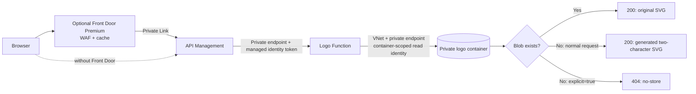

# Azure SVG logo fallback: API Management + Azure Functions

A Terraform demo for serving an existing SVG logo from private Blob Storage, or generating a two-character SVG when the logo is missing. Optional Azure Front Door Premium adds WAF protection and edge caching.

**Normal missing logos return HTTP 200 with a generated SVG.** Only an exact `explicit=true` query parameter suppresses generation and returns HTTP 404 for a missing logo. An existing logo still returns 200 with that parameter.

This repository packages the SVG demo as a reusable deployment. The Function behavior is tested locally; the new Terraform/APIM deployment requires an Azure acceptance run before production use. No existing customer resources are embedded in this repository.



APIM routes the request to the Function. The Function checks Storage and makes the fallback decision. Front Door does not execute VCL or automatically switch origins after a 404.

## Choose a deployment

| Mode | Creates | Reuses |
|---|---|---|
| [Full demo](terraform/examples/full-demo) | APIM Standard v2, private Function, storage, network, identity, monitoring; optional Front Door Premium/WAF | Optional existing logo catalog / app registration / Function plan |
| [Existing APIM](terraform/examples/existing-apim) | Function and required supporting resources; two isolated logo APIs and their policies | Existing APIM service, system identity and connected network; optionally catalog, DNS, app registration and plan |
| [Function only](terraform/examples/function-only) | Function and required supporting resources; no APIM or Front Door | Your gateway/caller; optionally network, DNS, catalog, app registration and plan |

All modes include an optional temporary private publisher VM. It uploads the code and fictional sample SVGs without enabling Storage public access. Remove it after verification, or disable it and use your own private runner. It is deployment tooling, not part of a logo request.

Start with the **[deployment guide](docs/deployment.md)**. For a shared gateway, first read **[existing APIM prerequisites](docs/existing-apim.md)**. The repository does not import, replace, or configure networking on an existing APIM service.

## Try the behavior

After deployment, open the Terraform `demo_url` output. The demo places fictional stored logos ACME/CONTOSO next to generated JEMXX/NEWCO logos.

| Request | If the SVG exists | If the SVG is missing |
|---|---|---|
| `/logos/JEMXX.svg` | Original SVG, 200 | Generated `JE`, 200 |
| `/logos/JEMXX.svg?explicit=true` | Original SVG, 200 | 404, `Cache-Control: no-store` |
| `/logos/fallback/JEMXX.svg` | Always generates; no lookup | Generated `JE`, 200 |
| `/logos/fallback/JEMXX.svg?explicit=true` | No lookup | 404, no-store |

`/static/v2/static/logos/{symbol}.svg` is an alias for lookup-first requests. `/logos/health` checks Function availability, not Storage readiness. `/logos/demo` is a public demo UI; remove it and its handler for a production-only API.

```sh
npm test
python3 scripts/package.py
terraform -chdir=terraform init -backend=false
terraform -chdir=terraform validate
terraform -chdir=terraform test
# After an Azure deployment:
python3 scripts/smoke.py https://YOUR-GATEWAY-HOST
```

See [VCL mapping and caching](docs/behavior.md), [security and operations](docs/security.md), and [validation scope](docs/validation.md).

## Repository contents

- `function/`: dependency-free Node.js 22 Azure Functions v4 application.
- `terraform/`: shared root, five modules, and three example variable files.
- `scripts/`: reproducible package, private upload, scoped Private Link approval and smoke checks.
- `assets/logos/`: original fictional sample artwork; no customer logos.
- `tests/` and `.github/workflows/`: local behavior and infrastructure validation.

This is a reference demo, not a production availability or capacity design. APIM Standard v2 and Front Door Premium have ongoing charges; the B1 Function plan is a demo starting point. Review sizing, resilience, monitoring and regional availability for the customer deployment.
