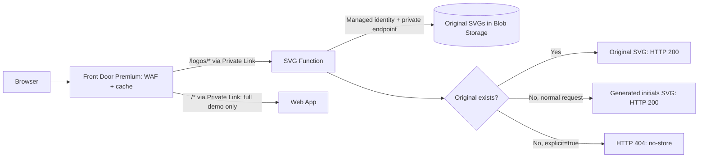

# SVG logo fallback on Azure

Serve an existing SVG logo from private Storage, or generate a two-character SVG when the logo is missing. Azure Front Door Premium caches the result; an Azure Function performs the lookup and fallback. The full demo also includes a private Web App as a separate origin.

**Deploy with Terraform or Azure CLI. Both support the same three options. No APIM is involved.**

## Choose what to deploy

| Option | What you get | When to choose it |
|---|---|---|
| **Full demo** (`full`) | New Front Door Premium + WAF, Function, two private Storage accounts, network, identity, monitoring and Web App | Try the complete flow in a separate environment |
| **Existing Front Door** (`existing_front_door`) | Private Function and dependencies, plus a new logo route/origin on your existing Premium endpoint | You already have Front Door and want the integration deployed for you |
| **Function only** (`function_only`) | Private Function and dependencies; no Front Door or Web App | Your team will connect the Function using its own Front Door configuration |

Network, Linux App Service plan and private logo catalog can be reused. “Function only” still needs runtime Storage, identity and private connectivity. Each installation must be managed by **one deployment tool**.

### Start deploying

1. Complete the short **[prerequisites and setup](docs/deployment.md)**.
2. Follow **[Terraform: five steps](docs/terraform.md)** or **[Azure CLI: five steps](docs/azure-cli.md)**. Each guide covers all three options.
3. Open `/logos/demo` and follow **[test the flow](docs/testing.md)**.
4. Remove the temporary uploader using the last step in your deployment guide.

For an existing environment, read **[Front Door integration and resource reuse](docs/existing-front-door.md)** before applying.

## How it works

On a cache hit, Front Door returns the SVG without calling the Function. On a miss, the Function reads the original from Storage and decides what to return. Front Door does not switch origins when a logo is missing. The Web App is a separate example website.

| Try this request | Expected result with the sample catalog |
|---|---|
| `/logos/ACME.svg` | Stored original, HTTP 200 |
| `/logos/JEMXX.svg` | Generated **JE**, HTTP 200 |
| `/logos/JEMXX.svg?explicit=true` | HTTP 404: caller requested an original only |
| `/logos/ACME.svg?explicit=true` | Stored original, HTTP 200 |
| `/logos/fallback/JEMXX.svg` | Generate **JE** directly, without a Storage lookup |

The demo seeds fictional **ACME** and **CONTOSO** logos in a new catalog. Reused catalogs are never seeded. Original images cache for 300 seconds, generated images for 60 seconds; query strings have separate cache keys. Generated colors are stable, but exact Fastly color parity is not claimed. See [behavior and VCL mapping](docs/behavior.md).

## What is in the repository?

| Location | Contents |
|---|---|
| [`function/`](function/) | Dependency-free Node.js 22 Function, SVG renderer and demo page |
| [`webapp/`](webapp/) | Small website used only by the full demo |
| [`assets/logos/`](assets/logos/) | Fictional original SVG fixtures |
| [`terraform/`](terraform/) | Terraform modules and three example configurations |
| [`azure-cli/`](azure-cli/) | Python/ARM deployment driver and three JSON examples; no Terraform or Bicep required |
| [`scripts/`](scripts/) | Packaging, private upload, Private Link approval and HTTP checks |
| [`tests/`](tests/) | Local application and deployment tests |
| [`docs/`](docs/) | Setup, deployment, integration, testing and security guides |

## Before using this with a customer

- **Private origins:** Function, Web App and Storage disable public network access. Front Door serves the public logo URLs. Storage browsing from a laptop also needs private network access and Blob data permissions.
- **Costs:** Front Door Premium, the App Service plan and other Azure resources remain billable until deleted. The temporary upload VM/NAT is removed after deployment; it is not part of the request flow.
- **Validation:** Both tools passed a full-mode Azure deployment and 23 HTTP acceptance checks per environment on 2026-10-19. The validation environments are temporary, not permanent demo sites. Existing-Front-Door and Function-only modes have configuration/mocked-plan coverage. Read the [validation scope](docs/validation.md).
- **Scope:** This is a working SVG migration demo, not a production sizing/HA design, DNS migration tool or photo converter. Review [security and operations](docs/security.md) before production use.
