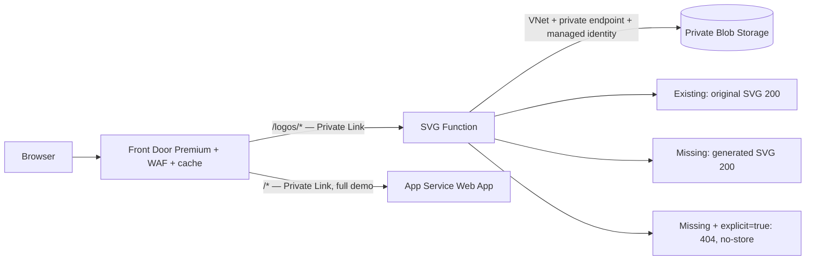

# Azure Front Door + private SVG Function + Storage + Web App

Serve stored company SVG logos through Azure Front Door Premium. If a logo is missing, an Azure Function generates a two-character SVG. The full demo also includes a private App Service Web App as a separate origin.

**Choose Terraform or Azure CLI. Both provide the same three deployment options.** The CLI path uses Azure CLI plus ARM JSON generated by Python; it needs neither Terraform nor Bicep.

| Option | Terraform `mode` / CLI `mode` | Result |
|---|---|---|
| Full demo | `full` | New Front Door Premium + WAF, private SVG Function, private Blob Storage, network/identity/monitoring and a private Web App |
| Existing Front Door | `existing_front_door` | Reuse a Premium profile and endpoint; add the logo origin/route and private Function dependencies. Existing Web App/default routes and WAF remain under their current owner |
| Function only | `function_only` | Function and required dependencies; no Front Door or Web App resources. Outputs show how to attach it to a Front Door Premium origin |

Existing private catalog, compatible Linux plan and network can be reused in both deployment methods. Each installation belongs to **one** tool; do not deploy Terraform and CLI over the same resources/state.



The Function makes the lookup/fallback decision. Front Door routes `/logos/*` directly to it and caches successful images. The Web App is a separate example origin; it does not process logos. Blob Storage holds the originals behind the Function, rather than acting as a second fallback origin.

## Start here

- **[Deployment chooser and prerequisites](docs/deployment.md)**
- **[Terraform instructions](docs/terraform.md)**
- **[Azure CLI instructions](docs/azure-cli.md)**
- **[Existing Front Door / Function-only integration](docs/existing-front-door.md)**

After deployment and Private Link approval, open the `demo_url`. Stored fictional ACME/CONTOSO SVGs appear beside generated JEMXX/NEWCO logos. In the full demo, `/` shows the private Web App example and links to `/logos/demo`.

| Request | Existing original | Missing original |
|---|---|---|
| `/logos/JEMXX.svg` | Original SVG, 200 | Generated `JE`, 200 |
| `/logos/JEMXX.svg?explicit=true` | Original SVG, 200 | 404, no-store |
| `/logos/fallback/JEMXX.svg` | Always generates, no lookup | Generated `JE`, 200 |

`/static/v2/static/logos/{symbol}.svg` is a lookup-first alias. The [VCL mapping](docs/behavior.md) explains case handling, prefix removal, query behavior and the color-parity limitation. Generated colors are deterministic; exact Fastly color matching is not claimed.

## Verify locally

```sh
npm test
python3 -m unittest discover -s tests -p 'test_*.py'
python3 scripts/package.py
# Terraform checks (only if using Terraform):
terraform -chdir=terraform init -backend=false
terraform -chdir=terraform validate
terraform -chdir=terraform test
# CLI-only offline render (replace the example placeholders first):
python3 azure-cli/deploy.py render --config my-demo.json
# After deploying either way:
python3 scripts/smoke.py https://YOUR-FRONT-DOOR-HOST
```

The deployment methods have automated configuration and behavior tests. They have **not yet completed an Azure end-to-end acceptance deployment**; follow the [validation checklist](docs/validation.md) before production use. No existing customer subscription IDs, credentials or live-resource configuration are committed here.

`function/` contains the dependency-free Node.js 22 SVG application, `webapp/` contains the small Node.js Web App example, `assets/logos/` contains fictional sample SVGs, and `scripts/` contains shared packaging/private-upload/smoke helpers.

Front Door Premium and the App Service plan have ongoing charges. The optional private publisher VM/NAT gateway is temporary deployment tooling; remove it after verification. This demo does not cover DNS migration, photo conversion, production sizing or high availability.
